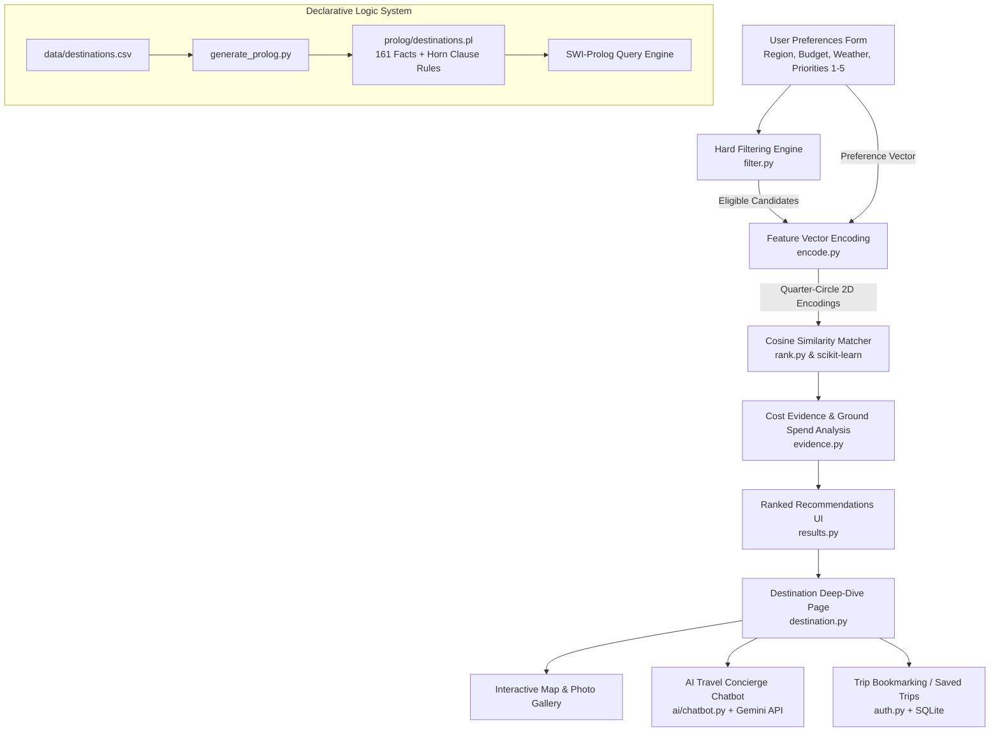

# TripSense AI — Intelligent Asian Travel Recommender & Concierge

> **Project Course:** CST_4104 Artificial Intelligence  
> **Institution:** University of Information Technology (UIT)  
> **Team Documentation & System Architecture Guide**

---

## 1. Executive Summary & Purpose

**TripSense AI** is a dual-paradigm, intelligent travel recommendation and advisory platform tailored for Asian destinations. It combines:

1. **Vector Space Machine Learning (Cosine Similarity)** in Python for multi-criteria, continuous similarity matching based on personalized traveler preferences.
2. **First-Order Declarative Logic Programming** in **Prolog** (SWI-Prolog) for rule-based, deductive knowledge querying and categorical inference.
3. **Generative AI (Google Gemini)** as a real-time destination concierge providing hyper-realistic itineraries, safety advice, cultural etiquette, and hidden gems.
4. **Transparent Evidence-Based Costing** using real ground-spending data, accommodation benchmarks, and currency metrics across 161 curated Asian destinations.
5. **Full-Stack Persistent Authentication & Bookmarking** powered by an embedded SQLite database with password hashing and session continuity across browser reloads.

This guide explains **how the system works**, **the core algorithms**, **the technology stack choices and justifications**, and **a complete breakdown of which file does what** to help all teammates understand and present the project with confidence.

---

## 2. System Architecture & End-to-End Workflow



### High-Level User Journey:
1. **Preference Gathering (`app_pages/home.py`)**: The user selects their target region (with dynamic country filtering), travel duration, weather preference, spending budget, and rates priority travel styles (Culture, Food, Nature, Nightlife, Shopping, Quietness, Adventure, Transit) on a 1–5 scale.
2. **Hard Filtering (`recommender/filter.py`)**: Removes locations that do not meet strict region, country, seasonal weather, or trip duration constraints.
3. **Vector Similarity Ranking (`recommender/rank.py`)**: Encodes user desires and candidate destinations into vector space and computes cosine similarity to establish a percentage match.
4. **Evidence-Based Ground Spending (`recommender/evidence.py`)**: Calculates verified daily expenses, affordability status, and confidence levels.
5. **Interactive Exploration & AI Concierge (`app_pages/destination.py`)**: The user browses destination highlights, local food, transportation notes, interactive OpenStreetMap views, and chats with the AI Travel Concierge.
6. **Account & Trip Bookmarking (`app_pages/saved_trips.py`, `recommender/auth.py`)**: Logged-in users can bookmark destinations, persisting saved trips in a SQLite database with automatic session recovery across browser reloads.

---

## 3. Core Algorithms in Detail

### 3.1. Why Cosine Similarity?
Cosine similarity measures the angle between two multi-dimensional vectors rather than their absolute Euclidean magnitude:

$$\text{Cosine Similarity}(\mathbf{u}, \mathbf{v}) = \cos(\theta) = \frac{\mathbf{u} \cdot \mathbf{v}}{\|\mathbf{u}\| \|\mathbf{v}\|} = \frac{\sum_{i=1}^n u_i v_i}{\sqrt{\sum_{i=1}^n u_i^2} \sqrt{\sum_{i=1}^n v_i^2}}$$

In travel recommendations, a user might rate Culture as 5/5 and Nature as 3/5. A destination with ratings 4/5 and 2.5/5 has the exact same *directional preference balance* as a destination with 5/5 and 3/5. Cosine similarity rewards destinations that match the **relative importance profile** of the traveler.

### 3.2. The 2D Quarter-Circle Ordinal Encoding Algorithm (`recommender/encode.py`)

#### The Problem with Simple Scalar Ratings:
If ratings (1 to 5) were encoded as simple 1D numbers:
- User rates: `[5]`
- Destination A rates: `[1]`
- Destination B rates: `[5]`

Because both numbers are positive scalars along the same single axis ($x > 0$), the angle between vector `[5]` and vector `[1]` is $0^\circ$ ($\cos(0) = 1.0$). **Under 1D cosine similarity, all positive ratings point in the exact same direction and collapse to a 100% match!**

#### The Quarter-Circle Solution:
To preserve geometric distance and directional variance under cosine similarity, ordinal ratings (1 to 5) are mapped to coordinates on a **2D quarter circle** ($[0, \pi / 2]$):

$$\text{span} = \text{max\_rating} - \text{min\_rating}$$
$$\text{position} = \frac{\text{rating} - \text{min\_rating}}{\text{span}} \in [0.0, 1.0]$$
$$\theta = \text{position} \times \frac{\pi}{2}$$
$$\mathbf{v}_{\text{feature}} = \left[ \sqrt{w} \cdot \cos(\theta), \; \sqrt{w} \cdot \sin(\theta) \right]$$

- When rating is at minimum (1): $\theta = 0 \implies [ \sqrt{w}, 0 ]$ (aligned with X axis).
- When rating is at maximum (5): $\theta = \frac{\pi}{2} \implies [ 0, \sqrt{w} ]$ (aligned with Y axis).
- Intermediate ratings sweep smoothly along the arc.

The dot product between a rating of 1 and a rating of 5 is $[1, 0] \cdot [0, 1] = 0.0$ (orthogonal, $0\%$ match), while identical ratings yield $1.0$ ($100\%$ match). This allows cosine similarity to accurately reflect preferences.

### 3.3. Hard Filtering Logic (`recommender/filter.py`)
Before vector calculation, a hard filter prunes candidates:
1. **Region / Country Filtering**: If a region or specific country is selected, all non-matching destinations are excluded.
2. **Weather Filtering**: If a specific weather (e.g., Cool, Warm, Hot) is selected, only matching climate locations are retained.
3. **Trip Duration Envelope**: Filters out places where the traveler's planned trip days cannot fit within `[trip_days_min, trip_days_max]`.
4. **Strict Budget Pruning**: If strict mode is enabled, places whose typical daily ground spend exceeds the daily budget or lack verified cost evidence are excluded.

### 3.4. Ground Spend & Evidence Modeling (`recommender/evidence.py`)
Unlike apps that display arbitrary "$-$$$-$$$" dollar signs, TripSense calculates daily ground spend (food, local transit, entry fees, daily necessities) from curated benchmarks:
- **Low ground spend:** Median ~$22/day (e.g., Southeast Asian cultural towns).
- **Medium ground spend:** Median ~$45/day (e.g., regional capitals).
- **High ground spend:** Median ~$85/day (e.g., tier-1 metropolitan centers).
- **Confidence Rating:** Evaluates whether prices are backed by primary local sources (`sufficient`), multi-city cross-references (`partial`), or regional benchmarks (`sparse`).

---

## 4. Prolog Knowledge Base & Declarative Logic

The project demonstrates a dual AI paradigm by contrasting continuous vector matching (Python) with **declarative logic programming** in Prolog (`prolog/destinations.pl`).

### 4.1. Facts Representation
Each destination has 15 distinct relational predicates:
```prolog
destination(bagan).
country(bagan, myanmar).
region(bagan, southeast_asia).
place_type(bagan, historical).
budget(bagan, low).
weather(bagan, hot).
trip_days(bagan, 2, 4).
culture(bagan, 5).
food(bagan, 3).
nature(bagan, 3).
nightlife(bagan, 1).
shopping(bagan, 2).
quiet(bagan, 4).
adventure(bagan, 3).
transport(bagan, 2).
```

### 4.2. Horn Clause Inference Rules
Rules define logical deduction across multi-criteria constraints:
```prolog
% Find quiet historical sanctuaries
quiet_historical(X) :-
    place_type(X, historical),
    quiet(X, Q),
    Q >= 4.

% Find nature escapes with serene surroundings
nature_escape(X) :-
    nature(X, N),
    N >= 4,
    quiet(X, Q),
    Q >= 3.

% Low-budget food havens in Southeast Asia
budget_foodie_southeast_asia(X) :-
    region(X, southeast_asia),
    budget(X, low),
    food(X, F),
    F >= 4.

% Multi-parameter query predicate
recommend_trip(X, Region, Budget, MinNature, MinCulture) :-
    region(X, Region),
    budget(X, Budget),
    nature(X, N), N >= MinNature,
    culture(X, C), C >= MinCulture.
```

### 4.3. Querying with SWI-Prolog
To query using Prolog:
```bash
swipl prolog/destinations.pl
```
```prolog
?- budget_foodie_southeast_asia(Place).
Place = bagan ;
Place = inle_lake ;
Place = yangon ;
...
```

---

## 5. Technology Stack & Selection Rationale

| Technology | Role in Project | Why We Chose It (Rationale) |
| :--- | :--- | :--- |
| **Python 3.13** | Core language | Standard language for AI, data science, and web scripting. Clean syntax and extensive ML library support. |
| **Streamlit (v1.40+)** | Web UI & Frontend | Enables building rich, responsive web applications in pure Python without needing a separate React/Vue frontend and REST API layer. Features `@st.dialog` modals and reactive session state. |
| **Scikit-Learn** | ML Vector Similarity | Provides highly optimized, C-accelerated `cosine_similarity` computation, preventing performance bottlenecks when ranking datasets. |
| **Pandas & NumPy** | Data Manipulation & Vector Math | Vectorized filtering, matrix construction, and mathematical operations ($\cos$, $\sin$, dot products). |
| **SQLite3 + Bcrypt** | Persistent Storage & Security | Embedded zero-configuration SQL database (`data/tripsense.db`). Stores user accounts, bcrypt-hashed passwords, persistent login tokens, and saved trip bookmarks without requiring an external PostgreSQL or MySQL server. |
| **Google GenAI SDK (Gemini)** | Conversational Travel Concierge | Provides state-of-the-art multimodal generative capabilities, high context limits, and rapid response generation for natural travel Q&A. |
| **SWI-Prolog** | Classical AI Logic System | Demonstrates first-order predicate logic, knowledge representation, unification, and resolution refutation required for university AI coursework. |
| **Pytest** | Automated Testing | Comprehensive 33-test suite covering authentication, vector math, cosine similarity sanity, image caching, and chatbot resiliency. |

---

## 6. Complete Directory & File Guide ("Which File Makes What?")

```
asian-travel-recommender/
│
├── streamlit_app.py               # Application entry point, routing, navbar & auth state
├── requirements.txt               # Project Python dependencies
├── pytest.ini                     # Pytest test suite configuration
├── .env                           # Local API keys (GEMINI_API_KEY)
│
├── app_pages/                     # User Interface Views (Streamlit Pages)
│   ├── home.py                    # Search & preference customization page
│   ├── results.py                 # Ranked recommendation results view
│   ├── destination.py             # Deep-dive destination page, map & AI chat
│   ├── saved_trips.py             # Bookmarked trips view for logged-in users
│   └── auth_dialog.py             # Pop-up modal dialog for Login & Sign Up
│
├── recommender/                   # Recommendation Engine & Business Logic
│   ├── rank.py                    # Top-K ranking using cosine similarity & budget
│   ├── encode.py                  # 2D quarter-circle ordinal & one-hot vector encoding
│   ├── filter.py                  # Hard filtering (region, country, weather, duration)
│   ├── prefs.py                   # Preference normalization & default handling
│   ├── evidence.py                # Ground spend calculation & cost confidence scoring
│   ├── auth.py                    # User auth, password hashing, SQLite session management
│   ├── catalog.py                 # In-memory dictionary catalog loader & fallback
│   ├── constants.py               # System constants (regions, countries, styling)
│   ├── explain.py                 # Human-readable explanation generation for recommendations
│   └── images.py                  # Unsplash photo fetching, caching & local fallback
│
├── ai/                            # Generative AI Agent Layer
│   ├── client.py                  # Google Gemini client initialization
│   ├── chatbot.py                 # Concierge system prompt & multi-turn chat handler
│   └── parser.py                  # Robust JSON/text output extractor for LLM responses
│
├── data/                          # Datasets & Persistent Storage
│   ├── destinations.csv           # Master database of 161 Asian travel destinations
│   ├── destination_costs.csv      # Daily ground spend estimates & verified cost benchmarks
│   ├── destination_bases.csv      # Geographic base hubs & transit points
│   ├── accommodations.csv         # OpenStreetMap accommodation counts & data points
│   ├── DATA_METHODOLOGY.md        # Documentation on data sourcing & collection standards
│   └── tripsense.db               # SQLite database (users, sessions, saved trips)
│
├── prolog/                        # Declarative Logic Programming
│   ├── generate_prolog.py         # Script to convert destinations.csv into Prolog facts/rules
│   └── destinations.pl            # Generated knowledge base for SWI-Prolog
│
├── tests/                         # Automated Unit & Integration Tests (33 tests)
│   ├── test_recommender.py        # Vector encoding, cosine similarity, and filter tests
│   ├── test_auth.py               # User registration, authentication & session tests
│   ├── test_evidence.py           # Cost confidence & ground spend calculation tests
│   ├── test_chatbot.py            # AI prompt assembly & mock conversation tests
│   ├── test_images.py             # Image retrieval & offline fallback tests
│   └── test_prolog.py             # Prolog atom escaping and character safety tests
│
└── assets/                        # Local image assets & destination photography
```

---

## 7. How to Run, Test, and Present the Project

### 7.1. Setup & Installation
1. Clone the repository and enter the folder:
   ```bash
   cd asian-travel-recommender
   ```
2. Activate the virtual environment:
   - **Windows:**
     ```bash
     .venv\Scripts\activate
     ```
   - **macOS / Linux:**
     ```bash
     source .venv/bin/activate
     ```
3. Install dependencies:
   ```bash
   pip install -r requirements.txt
   ```
4. Configure your `.env` file with your Gemini API key:
   ```env
   GEMINI_API_KEY=your_actual_api_key_here
   ```

### 7.2. Launching the Web App
Run the Streamlit application:
```bash
streamlit run streamlit_app.py
```
Open your browser at `http://localhost:8501`.

### 7.3. Running Automated Tests
Verify system integrity by running all 33 unit tests:
```bash
python -m pytest
```

### 7.4. Regenerating & Testing Prolog Knowledge Base
1. Regenerate Prolog facts and rules from the CSV catalog:
   ```bash
   python prolog/generate_prolog.py
   ```
2. Run SWI-Prolog:
   ```bash
   swipl prolog/destinations.pl
   ```
3. Query sample rules:
   ```prolog
   ?- nature_escape(X).
   ?- budget_short_trip(X).
   ?- recommend_trip(X, southeast_asia, low, 4, 4).
   ```

---

## 8. Team Members & Individual Contributions

This project was collaboratively developed by five team members as part of the CST_4104 Artificial Intelligence course at the University of Information Technology (UIT), Yangon, Myanmar.

Each team member contributed to a specific area of the system, including AI development, machine learning, user interface design, data management, and system testing.

| No. | Team Member | Roles & Responsibilities |
|:---:|---|---|
| 1 | **Phyo Khant Kywal** | Developed natural-language preference parsing, the destination chatbot, evidence processing, and Prolog knowledge-base rules. |
| 2 | **Myintzu Khaing** | Designed the Streamlit pages, navigation, responsive interface, and Asia-themed user interface (UI). |
| 3 | **Eaint Hmue Nge** | Implemented quarter-circle preference encoding, weighted cosine-similarity matching, evidence-based affordability filtering, and Vector Space Machine Learning. |
| 4 | **Ye Lin Aung** | Developed preference normalization, region/country filtering, and validation of user inputs. |
| 5 | **Yan Myo Aung** | Collected and structured destination data, verified cost and accommodation sources, tested system features, and supported deployment. |

### Team Collaboration

All five members contributed to the development of TripSense AI through their respective responsibilities. Their combined efforts brought together machine learning, symbolic AI, generative AI, data processing, and web application development.
